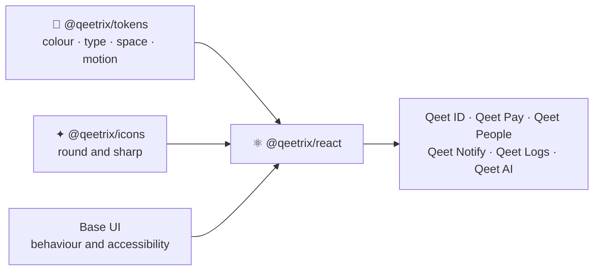

<div align="center">

# ⚛️ Qeetrix React

**The React components of Qeetrix, the Qeet Group design system: accessible, token-driven and made for India.**

[](https://www.npmjs.com/package/@qeetrix/react)
[](https://github.com/qeetgroup/qeetrix-react/actions/workflows/ci.yml)
[](https://react.dev)
[](https://base-ui.com)
[](#-whats-inside)
[](LICENSE)

[🌐 ui.qeet.in](https://ui.qeet.in) · [🚀 Quick start](#-quick-start) · [🧩 Components](#-components) · [📝 Changelog](packages/react/CHANGELOG.md) · [🤝 Contributing](AGENTS.md)

</div>

## 📦 What's inside

| | |
|:--|:--|
| ♿ **Accessible by default** | Behaviour from Base UI's WAI-ARIA patterns; every component tested with axe, in forced colours and with reduced motion |
| 🎨 **Tokens, never raw values** | Colour, type, space, corners, shadows and motion come from `@qeetrix/tokens`, so every Qeet product looks the same |
| 🇮🇳 **Made for India** | English and Hindi built in; rupees, numbers and dates formatted for `en-IN` and `hi-IN` |
| 🌗 **Every mode** | Light and dark, three densities, right to left, all switched with attributes your app already owns |
| 🖥️ **Server-friendly** | Layout, type and display components render in React Server Components; the rest carry their own `"use client"` |
| ⚡ **Light to load** | ES modules, one entry and one stylesheet per component, size budgets on every one |
| 🔒 **Built to be trusted** | Published with npm provenance; every public API change tracked in an API report |

## 🔗 How it fits



## 🚀 Quick start

```sh
bun add @qeetrix/react @qeetrix/tokens @qeetrix/icons @base-ui/react
```

```css
/* Once, in your root stylesheet: the tokens first. */
@import "@qeetrix/tokens/tokens.css";
@import "@qeetrix/react/styles.css" layer(components);
```

```tsx
import { PlusIcon } from "@qeetrix/icons/icons/plus";
import { Button, QeetrixProvider, Stack, TextField } from "@qeetrix/react";

export function App() {
  return (
    <QeetrixProvider locale="en-IN" defaultColorScheme="system">
      <Stack gap="lg">
        <TextField label="Work email" name="email" type="email" required />
        <Button icon={PlusIcon}>Invite users</Button>
      </Stack>
    </QeetrixProvider>
  );
}
```

React 19.2+, Base UI 1.9+ and `@qeetrix/tokens` 0.0.13 or later in 0.0.x. With Tailwind v4, the
[package guide](packages/react/README.md) shows the layer order; it also covers forms, overlays, locales and the
console frame.

## 🧩 Components

| Channel | Import | What's there |
|:--|:--|:--|
| **Stable** | `@qeetrix/react` | Layout, type, actions, forms, overlays, navigation, tables and status: `Button`, `TextField`, `Select`, `Dialog`, `Menu`, `Tabs`, `Table`, `Badge` and more |
| **Experimental** | `@qeetrix/react/experimental` | Components in their first product: the console frame, dates, charts, search, data display. Their API may change in a patch, always with a changelog note |

Every component, with live examples and its props, is on **[ui.qeet.in/components](https://ui.qeet.in/components)**.

## 🛠️ Develop

[Bun](https://bun.sh) 1.3.14 and Node 22+.

```sh
bun install && bun install --cwd tools/eslint
bun run build            # the package and its stylesheets
bun run test             # real-browser and server tests
```

Before every push, run the whole local gate: build, typecheck, Biome, compiler lint, the package checks and the
tests with coverage. [AGENTS.md](AGENTS.md) lists it, with the rules every component follows.

## 🚢 Releases

Work lands on `develop`. A pull request from `develop` into `main` with the version raised (and its
[changelog](packages/react/CHANGELOG.md) section) releases it: merging publishes to npm with provenance and tags
`vX.Y.Z`.

## 🗂️ The Qeetrix family

| Repository | Package | What it is |
|:--|:--|:--|
| **qeetrix-react** | [`@qeetrix/react`](https://www.npmjs.com/package/@qeetrix/react) | The React components (this repository) |
| [qeetrix-tokens](https://github.com/qeetgroup/qeetrix-tokens) | [`@qeetrix/tokens`](https://www.npmjs.com/package/@qeetrix/tokens) | Design tokens: CSS variables, DTCG files and `brandTheme()` |
| [qeetrix-icons](https://github.com/qeetgroup/qeetrix-icons) | [`@qeetrix/icons`](https://www.npmjs.com/package/@qeetrix/icons) | Icons in round and sharp, and the Qeet logos |
| [qeetrix-ios](https://github.com/qeetgroup/qeetrix-ios) · [qeetrix-android](https://github.com/qeetgroup/qeetrix-android) | Swift · Kotlin | Qeetrix for the iOS and Android apps |
| qeetrix-docs | [ui.qeet.in](https://ui.qeet.in) | The documentation site |

## 📄 License

[MIT](LICENSE) © Qeet Group · Security issues: report them privately, as [SECURITY.md](SECURITY.md) describes.
